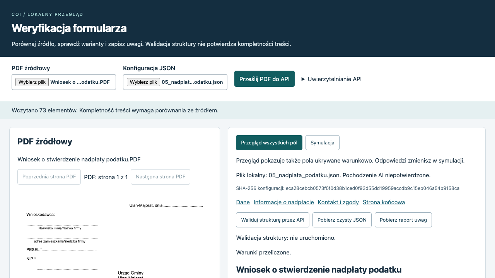

# Forumłarz

**Z papierowego formularza urzędowego tworzy szkic konfiguracji JSON dla Generatora Formularzy COI — do sprawdzenia i poprawienia przez urzędnika.** Projekt zespołu Formularze na HackNation 2026, zadanie „Cyfryzacja formularzy”.

## Zgłoszenie

[Film konkursowy z polskim lektorem (67 s, MP4)](https://raw.githubusercontent.com/HackNation2026-dev/formularze/2e46e3536d9f2c7e3f94d675132954f5343efbc1/docs/06-prezentacja/HackNation-COI-demo-67s.mp4)



Zrzut wcześniejszej wersji `/review/`: PDF i referencyjny JSON COI, nie wynik AI.
[Nagranie lokalnego prototypu — 112 s](docs/06-prezentacja/forumlarz-demo.mp4) · [Szkic prezentacji — 10 slajdów](docs/06-prezentacja/prezentacja-szkic-2026-11-22.pdf)

## Od blankietu do formularza elektronicznego

Sam PDF do pobrania nie jest jeszcze e-usługą. Trzeba rozpoznać wymagane dane, oddzielić role osób, zaplanować strony i zależności, a potem zapisać konfigurację COI. Forumłarz przygotowuje taki szkic do przeglądu.

Urzędnik wgrywa **niewypełniony blankiet**: PDF, DOC/DOCX, ODS, XLSX, JPG/JPEG lub PNG. Otrzymuje `FormDefinition` — strony, sekcje, pola, typy, opcje i warunki. W interfejsie **`/review/`**, głównej ścieżce demonstracji z Dockera, może:

- porównać PDF źródłowy z formularzem, także z polami ukrywanymi warunkowo;
- zmieniać odpowiedzi w symulacji i sprawdzać widoczność oraz blokowanie pól;
- poprawić etykietę lub typ pola, usunąć pole, zgłosić błąd albo brakującą informację;
- pobrać czysty JSON i osobny raport uwag przypisany do skrótu konfiguracji;
- przesłać wsad plików i przełączać się między wynikami.

Szybka korekta nie jest pełnym edytorem COI. Podgląd źródła dotyczy PDF; przy innych formatach potrzebny jest osobny przegląd dokumentu. Symulacja nie podpisuje ani nie wysyła wniosku do urzędu. [Instrukcja interfejsu](docs/08-implementacja/UI-PRZEGLAD.md).

## Co daje rozwiązanie

- **Własny model i infrastruktura:** Qwen3.5-4B w llama.cpp, lokalnie na CPU lub na własnym serwerze GPU. Analiza nie wymaga komercyjnego API modeli.
- **AI do treści, kod do struktury:** model proponuje pola i zależności, a deterministyczny kompilator buduje konfigurację COI, szablony danych i kontaktu, słowniki oraz walidatory.
- **Przegląd przed użyciem:** źródło, symulacja i uwagi pomagają ocenić wynik. Odpowiedzi testowe i raport nie trafiają do eksportu COI.
- **API do integracji:** JWT, kontrola nazwy i zawartości pliku, limit rozmiaru, analiza pojedyncza i wsadowa. Przesłane pliki są przetwarzane tymczasowo.

## Jak to działa

**Odczyt dokumentu → ekstrakcja → kompilacja COI → walidacja → przegląd.**

Magika rozpoznaje typ zawartości. Parsery odczytują tekst i układ; PDF łączy warstwę tekstową z OCR Tesseract (`pol`) dla stron z małą ilością tekstu. Model proponuje treść w pośrednim `FormSpec`, ze schematem odpowiedzi ograniczającym jej kształt. Kompilator tworzy `FormDefinition`, a walidator sprawdza reguły techniczne i wyrażenia JSONata. Urzędnik porównuje wynik ze źródłem i sprawdza warianty.

## Pomiary (stan 22.11)

W repo są [wyniki dziewięciu formularzy](data/output/): dwóch referencyjnych i siedmiu do oceny. Według zapisu wsadu z 22 listopada wygenerowano je na GPU GTX 1660 Ti, kodem `d3f0b65`, bez fallbacku heurystycznego; wszystkie przeszły reguły techniczne. To **nie potwierdza kompletności treści** ani poprawnego importu COI.

Na dwóch znanych referencjach 01/05 F1 wszystkich pól wyniosło **0,86 / 0,84**, a samego przedmiotu wniosku **0,75 / 0,50**. Metryka dopasowuje pola po nazwach technicznych lub podobieństwie etykiet. Szablonowe strony podnoszą wynik; F1 nie jest oceną całej semantyki formularza. Osobna metryka wykonuje wybrane warunki SHOW na wektorach odpowiedzi. [Metoda](src/formgen/eval/metric.py) · [Zakres ewaluacji](docs/05-weryfikacja/README.md).

Zapis testu dostawy na x86 **i7-9750H, 12 vCPU, bez GPU**, dla tego backendu podaje 14/14 kontroli `verify_stack.sh` i **85 s** analizy PDF 05 lokalnym modelem. To pojedynczy znany formularz, nie gwarantowany czas ani pomiar nowych dokumentów. [Szczegóły i historia pomiarów](docs/08-implementacja/KONFIGURACJA-I-API.md#pomiary-stan-2211). Testy kodu i UI sprawdzają regresje; ich liczba nie mierzy jakości ekstrakcji.

### Ograniczenia i fallback

- **Poprawny technicznie JSON nie oznacza kompletności ani poprawnych warunków.** Nowe dokumenty, OCR i różne układy wymagają przeglądu. Nie przedstawiamy walidatora jako dowodu importu w COI.
- Klient może przejść z głównego endpointu na skonfigurowany model zapasowy, a po wybranych błędach ekstrakcji — na heurystykę, jeśli ją włączono. Heurystyka także może zawieść; błąd odczytu, timeout lub naruszenie reguł może zakończyć analizę błędem.
- `X-Extractor` wskazuje ekstraktor, a `X-Partial-Result` i `X-Partial-Reasons` zgłaszają wykryte pominięcia, ucięcie odpowiedzi lub fallback. Brak flagi częściowego wyniku nie dowodzi zachowania całej treści.
- Symulacja nie zastępuje rejestrów, właściwych klauzul urzędu ani odbioru przez użytkownika. Wynik na nowych formularzach i w Generatorze COI wymaga osobnej weryfikacji.

## Uruchomienie

Rekomendowana ścieżka: **Docker Compose → `/review/`**. Wymagania: Git, Docker z Compose v2+, Python 3 do skopiowania materiałów oraz `curl`. Pracuj w katalogu głównym repozytorium, obok `compose.yaml`. Potrzebne są miejsce na obrazy i model (~2,74 GB) oraz RAM na model i kontekst; minimum całego zestawu nie zmierzono. Model w domyślnym Compose działa na CPU. Zasoby UI buduje Dockerfile — Node na hoście nie jest potrzebny.

1. Pobierz repozytorium i przygotuj kopie materiałów organizatora:

   ```sh
   git clone https://github.com/HackNation2026-dev/formularze.git
   cd formularze
   git switch main
   python3 scripts/sync_materials.py
   cp .env.example .env
   mkdir -p models
   curl --fail --location --retry 3 \
     'https://huggingface.co/unsloth/Qwen3.5-4B-GGUF/resolve/main/Qwen3.5-4B-Q4_K_M.gguf' \
     -o models/Qwen3.5-4B-Q4_K_M.gguf
   ```

2. W `.env` zastąp `JWT_SECRET` losowym kluczem, np. wynikiem `openssl rand -hex 32`. Pozostaw `AUTH_ENABLED=true`. Na demonstrację AI dodaj `EXTRACTOR=llm` i `LLM_FALLBACK_HEURISTIC=false`, aby awaria modelu nie była zastępowana heurystyką.

3. Zbuduj usługi, uruchom je i poczekaj na model:

   ```sh
   docker compose up -d --build
   docker compose logs llm
   curl --fail http://localhost:8000/ready
   ```

   Po załadowaniu modelu `/ready` powinno zwrócić `status: ok` i `llm_alive: true`. Przedtem powtórz sprawdzenie. Pobieranie obrazów, pakietów i wag wymaga sieci podczas przygotowania; domyślna analiza korzysta z własnych usług.

4. Wygeneruj JWT z konfiguracji działającego kontenera:

   ```sh
   TOKEN="$(docker compose exec -T api python -c \
     'from formgen.config import get_settings; from formgen.api.security import issue_token; print(issue_token(get_settings()))')"
   printf '%s\n' "$TOKEN"
   ```

   Otwórz **<http://localhost:8000/review/>**, wpisz token bez prefiksu `Bearer` w „Uwierzytelnianie API” i prześlij PDF `data/input/01_przyklady_formularze/05_nadplata_podatku/Wniosek o stwierdzenie nadpłaty podatku.PDF`. Do przeglądu bez generacji wczytaj odpowiadający mu referencyjny JSON z `data/input/02_przyklady_json/`.

**Alternatywa: [GUI Next.js w `apps/web`](apps/web/README.md)** — kolejka, JSON, walidacja, podgląd, PL/EN. Domyślnie używa prawdziwego API; mock wymaga jawnego włączenia. Działa osobno od obrazu backendu, wymaga Node/npm i poprawnego `API_INTERNAL_URL` dla proxy. Edycja i raport uwag tego GUI pozostają planem; dostępne są w `/review/`.

**Własny endpoint GPU:** to utrzymywany przez zespół serwer otwartego modelu, nie zewnętrzny dostawca modeli. API wysyła do niego odczytaną treść przez HTTP. Samo `LLM_BASE_URL` w `.env` nie przełącza domyślnego Compose — trzeba nadpisać adres zdefiniowany w usłudze. [Konfiguracja endpointu i zapasu](docs/08-implementacja/KONFIGURACJA-I-API.md#własny-endpoint-gpu) · [Skrypt serwera demo](scripts/legion/serve_gpu.sh).

## API i dokumentacja

Swagger: <http://localhost:8000/docs>. Analiza przyjmuje jeden plik multipart `file`; sukces zwraca bezpośrednio konfigurację COI:

```sh
curl --fail-with-body --show-error \
  http://localhost:8000/api/v1/forms/analyze \
  -H "Authorization: Bearer $TOKEN" \
  -F 'file=@data/input/01_przyklady_formularze/05_nadplata_podatku/Wniosek o stwierdzenie nadpłaty podatku.PDF' \
  -D wynik.headers -o wynik.json
```

Sprawdź kod HTTP i nagłówki przed użyciem `wynik.json`; przy błędzie plik może zawierać opis błędu. API udostępnia też analizę wsadową (`/api/v1/forms/analyze-batch`), walidację konfiguracji i przykładowych wartości (`/api/v1/forms/validate`) oraz listę formatów (`/api/v1/formats`).

- [Konfiguracja, pełny kontrakt API, błędy i pomiary](docs/08-implementacja/KONFIGURACJA-I-API.md)
- [Architektura](docs/08-implementacja/architektura.md) · [Moduły](docs/08-implementacja/MODULY.md) · [Licencje](docs/08-implementacja/LICENSES.md)
- [Materiały i pochodzenie](docs/02-materialy/README.md) · [Wymagania COI](docs/03-wymagania/README.md)
- [Prezentacja i pochodzenie nagrania](docs/06-prezentacja/README.md) · [Indeks dokumentacji](docs/README.md)

Kontrola dokumentacji: `python3 scripts/verify_docs.py`. Kontrola aplikacji i dostawy: [plan weryfikacji](docs/05-weryfikacja/README.md). [Stan zespołu](docs/08-implementacja/STAN-PROJEKTU.md) i [historia zmian](CHANGELOG.md) zawierają szczegóły poza ścieżką demonstracji.
